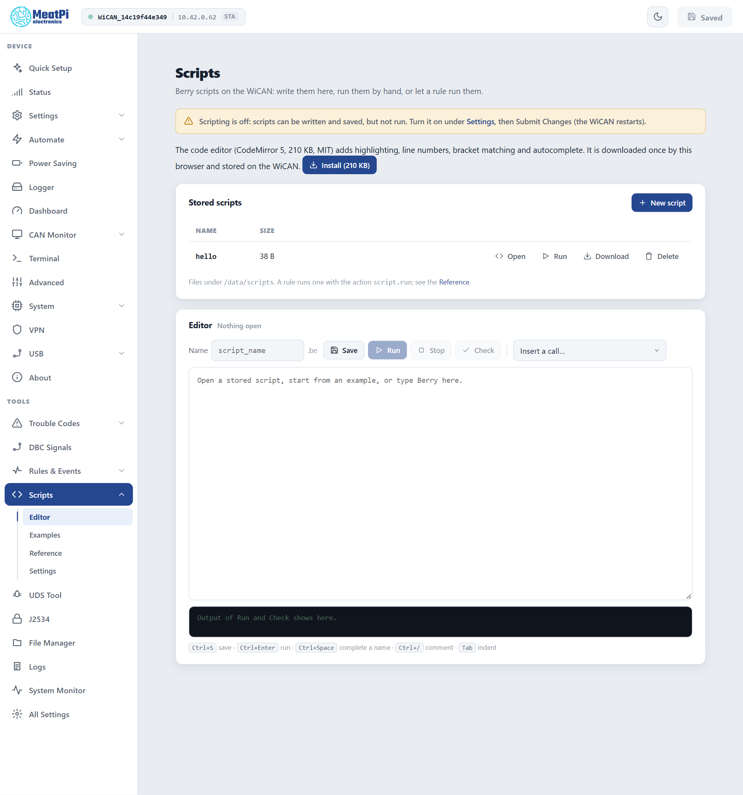

# Scripts

<p class="lead">For what a rule cannot say in one line: a UDS conversation across several requests, a trouble-code report with descriptions, a sequence of CAN frames, a computation before an event goes out. Scripts are written in Berry, a small language in the Python family, edited and run in the browser, and a rule can start one.</p>

## Switch scripting on

Scripting is off out of the box: scripts can be written and saved, not run. ==Scripts== › ==Settings== › ==Enabled==, then ==Submit== (WiCAN restarts). The same card holds the ==Runtime budget== (10 s by default, up to 120 s: a script past it is stopped), ==Allow ECU flashing== (off: the UDS services that write ECU memory are refused to scripts until it is on) and ==Exclusive bus== (on: from a script's first request to the end of its run, AutoPID polling and trouble-code scans stay off the bus).

## The editor

<figure class="shot" markdown>
{ width="640" }
<figcaption>Scripts, Editor, before the code editor is installed.</figcaption>
</figure>

- **Stored scripts** lists the files under `/data/scripts` with ==Open==, ==Run==, ==Download== and ==Delete==; ==New script== starts an empty one. Names use letters, digits, `_`, `.` and `-`, up to 40 characters; the `.be` extension is added.
- **The editor** card: the name, ==Save==, ==Run== (the editor's text as it is; a script over 8 KB is saved and run by name), ==Stop== (the kill switch), ==Check== (compile only) and ==Insert a call...== (every binding with its signature). The output of a run or check appears underneath: a line naming `string:<line>:` is a link to that line, and a hint from the firmware shows under common errors.
- **Shortcuts**: ++ctrl+s++ save, ++ctrl+enter++ run, ++ctrl+space++ complete a name, ++ctrl+slash++ comment, ++tab++ indent.
- **The code editor** (CodeMirror: highlighting, line numbers, bracket matching, completion) is not in the firmware: ==Install== downloads it once through your browser and stores it on WiCAN; a plain text area works until then.

==Examples== is a gallery of scripts the firmware ships, each run against the bench ECU simulator; ==Reference== lists every binding, the readable globals, a Berry primer and the error hints, rendered from the firmware itself so it never lags behind the bindings.

## Three scripts the device ships

`hello`: output, variables, loops and timing, nothing talks to the vehicle.

```berry
log('Hello from WiCAN')
var boot = millis()                 # milliseconds since the WiCAN booted
var total = 0
for i : 1..5                        # 1..5 is inclusive
  total += i
  log(format('step %d, running total %d', i, total))
  sleep_ms(200)                     # pause 0.2 s (the run budget keeps counting)
end
log('done in ' + str(millis() - boot) + ' ms')
```

`vin`: one UDS request, the answer as a hex string, the globals that say how it went.

```berry
import string

def text_from(resp, from)           # the bytes of a hex answer from position `from` as text
  var parts = string.split(resp, ' ')
  var b = bytes()
  for i : from..size(parts) - 1
    b.add(int('0x' + parts[i]), 1)
  end
  return b.asstring()
end

var r = uds(0x7DF, 0x7E8, '09 02')
if r != nil && string.startswith(r, '49 02')
  log('VIN (mode 09): ' + text_from(r, 3))
else
  r = uds(0x7E0, 0x7E8, '22 F1 90')
  if r != nil && string.startswith(r, '62 F1 90')
    log('VIN (DID F190): ' + text_from(r, 3))
  elif uds_nrc >= 0
    log('the ECU refused: ' + uds_nrc_str(uds_nrc))
  else
    log('no answer')
  end
end
```

`on_event`: a script a rule runs. The trigger's fields arrive as globals, and what the script emits can drive further rules.

```berry
import global

if evt_source == ''
  log('run by hand: no trigger event')
else
  log('triggered by ' + evt_source + '.' + evt_name)
end

var result = 'ok at ' + str(millis()) + ' ms'
if global.contains('evt_param')     # a field exists only when the trigger carries it
  result = global.member('evt_param') + '=' + str(global.member('evt_value'))
end

emit('script', 'done', 'value', result)   # a rule on script.done can read ${value}
```

## The bindings

| Group | Binding | What |
| --- | --- | --- |
| Output and timing | `log(msg)`, `sleep_ms(ms)`, `millis()` | a line in the output; a pause (60 s at most); the uptime |
| One request at a time | `uds(tx, rx, hexreq)`, `uds_ext(tx, rx, hexreq)` | a UDS request on 11-bit or 29-bit ids: the positive answer as a hex string, or `nil` with `uds_ok`, `uds_nrc` and `uds_pending` set; `uds_nrc_str(nrc)` names a negative response |
| A conversation on a claimed bus | `obd_claim(tx, rx[, ext])`, `obd_request(hexreq[, timeout_ms])`, `obd_isotp_tx(hexbytes[, ms])`, `obd_isotp_rx([ms])`, `obd_release()` | hold one ECU across several requests with tester present kept alive (security access, writes); raw ISO-TP frames; the claim is released at the end of the run in any case |
| Trouble codes | `dtc_scan()`, `dtc_clear([codes[, mode]])`, `dtc_desc(code)` | a scan and a clear with the same gates as the page; a description from the uploaded databases |
| Raw CAN | `can_tx(id, ext, hexbytes)` | one frame on WiCAN's CAN interface (normal mode, a proven bit rate) |
| Events and rules | `emit(source, name, key, value)` | publishes `script.done` for rules to chain on |
| SD card files and flashing | `obd_file_size(path)`, `obd_file_read(path, offset, len)`, `obd_transfer_file(path, offset, size, block_len[, bsc])` | read a file on the SD card; stream it to an ECU as UDS transfer blocks (needs ==Allow ECU flashing==) |

Readable globals: `uds_ok`, `uds_nrc`, `uds_pending`, `uds_xfer_crc`, `uds_xfer_blocks`, and from a rule `evt_source`, `evt_name` and one `evt_<field>` per event field. In Berry a bare name that was never set is a compile error: test with `global.contains('evt_param')` first.

## Run a script from a rule

In ==Rules & Events== pick the trigger, the action ==Run script== and the script's name (the stored form is `{"on": "...", "script": "name"}`). The trigger's fields reach the script as the `evt_*` globals. An event-triggered run blocks the rule dispatcher for its duration, so keep such scripts short; a long conversation belongs to a run by hand or a timer rule with a cooldown.

## Flashing an ECU from a script

`obd_transfer_file` streams a firmware file from the SD card as `36` transfer blocks, honours the ECU's block length and accumulates a CRC-32 in `uds_xfer_crc`; the script owns the sequence around it (session, security access, request download, the transfer, check memory, reset). The firmware repository carries a reference script (`tools/testbench/reflash.be`). It needs ==Allow ECU flashing== on; a script that tries without it stops with a clear error.

## Limits

| | |
| --- | --- |
| Script file | up to 64 KB; an inline run from the editor up to 8 KB |
| Output of a run | up to 4 KB |
| A sleep | up to 60 s per call |
| An answer | up to 128 bytes through `uds()`; raw ISO-TP for more |
| Runtime | the budget in the settings, 10 s by default |
| One script at a time | a second run while one is busy is refused |

## Troubleshooting

| Symptom | Likely cause | What to do |
| --- | --- | --- |
| `Scripting is off` | the engine is disabled | ==Scripts== › ==Settings== › ==Enabled==, ==Submit== |
| `syntax_error: string:3:` | a Berry syntax error on that line | click the line; the hint under the output |
| `busy` | another script is running | ==Stop==, or wait |
| The run stops with a budget error | the script took longer than the runtime budget | shorter sleeps, or a bigger budget |
| `uds()` returns `nil` with `uds_ok` false | a negative response or no answer | `uds_nrc_str(uds_nrc)`; ignition; the ids |
| A flashing call is refused | ==Allow ECU flashing== is off | switch it on for the job |
