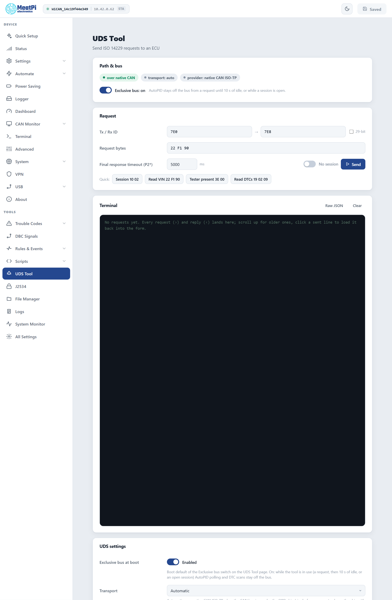

# UDS Tool

Send a diagnostic request (ISO 14229, UDS) to an ECU by hand and read the answer decoded: read a data identifier, open a session, keep it alive, list trouble codes. The tool goes over WiCAN's own CAN interface with ISO-TP, or through the OBD chip when that is the only path, and keeps WiCAN's own polling off the bus while you work.

<figure class="shot" markdown>
{ width="640" }
<figcaption>UDS Tool, ready for a request to the engine ECU.</figcaption>
</figure>

## Path and bus

The first card says which path a request takes: ==over native CAN== (the CAN interface with WiCAN's own ISO-TP) or ==over the OBD chip==, the transport setting and the provider. ==Transport== ==Automatic== uses the native path when the CAN interface runs in normal mode (==Settings== › ==CAN bus==), and the chip otherwise. The native path is the better one: faster, any id, long answers; the chip covers the standard 11-bit ids `7E0` to `7E7` (answers on `7E8` to `7EF`) and the 29-bit `18DAxxF1` form.

==Exclusive bus== (on by default): from a request until 10 seconds of quiet, and for as long as a session is open, AutoPID polling and trouble-code scans stay off the bus, so the answer you get is to your request. The Dashboard's values pause meanwhile.

## Send a request

<dl class="facts" markdown>
<dt>Tx / Rx ID</dt><dd>The id WiCAN sends on and the id the ECU answers on: `7E0` and `7E8` for the engine ECU of most cars. Tick ==29-bit== for extended ids.</dd>
<dt>Request bytes</dt><dd>The service and its data, hex, spaces optional: `22 F1 90` reads the VIN, `10 03` opens the extended session, `19 02 09` lists confirmed trouble codes.</dd>
<dt>Final response timeout (P2*)</dt><dd>How long to wait after the ECU says `7F xx 78` (response pending): 5 s by default. The first answer itself is expected within P2 (250 ms).</dd>
<dt>Session</dt><dd>Off: one request, one answer. On: WiCAN keeps the ECU's session open with a tester-present message every 2 s and holds the bus, so a conversation (session, security access, reads, writes) stays on one ECU.</dd>
</dl>

The quick buttons send the usual first steps: ==Session 10 02==, ==Read VIN 22 F1 90==, ==Tester present 3E 00==, ==Read DTCs 19 02 09==.

## The terminal

Every request (`›`) and reply (`‹`) lands in the terminal, newest at the bottom: a positive answer with its bytes, or the negative response code with its ISO name (`conditionsNotCorrect`, `securityAccessDenied` ...), the response-pending frames counted, the time it took and the path used. A VIN or another text identifier is shown as text as well. Click a sent line to load it back into the form; ==Raw JSON== shows the firmware's answer as it came; ==Clear== empties the terminal, which the browser otherwise keeps across visits.

## Settings

<dl class="facts" markdown>
<dt>Exclusive bus at boot</dt><dd>The default of the switch above.</dd>
<dt>Transport</dt><dd>==Automatic==, ==OBD chip== or ==native CAN ISO-TP==.</dd>
<dt>P2, P2*, tester present</dt><dd>250 ms, 5000 ms and 2000 ms by default.</dd>
</dl>

Changes apply from ==Submit== (WiCAN restarts); the exclusive switch also applies at once.

## From rules and scripts

A rule can send a request with the ==UDS request== action and react to its outcome with the `uds.response` trigger (the answer truncated to a few bytes). A [script](scripts.md) gets the whole answer with `uds()` and can hold a session across several requests, which is the way to do security access or a flash.

## Limits

- One transaction at a time: a second request, or a request while another tool holds the bus, is answered `busy`.
- WiCAN refuses to send on a bus that runs at another bit rate than the protocol in use (the bus guard): a live 250 kbit/s bus gets no 500 kbit/s request.
- A request is at most 64 bytes; an answer up to 4 KB over the native path.

## Troubleshooting

| Symptom | Likely cause | What to do |
| --- | --- | --- |
| Timeout, no answer | ignition off, wrong ids, or the ECU does not answer that service | ignition on; `7E0` and `7E8` first; try `3E 00` |
| `serviceNotSupported` (`11`) or `subFunctionNotSupported` (`12`) | the ECU has no such service or sub-function | the vehicle's documentation |
| `conditionsNotCorrect` (`22`) or `securityAccessDenied` (`33`) | the request needs a session or security access first | ==Session== on, `10 03`, then the request |
| `busy` | another request, an open session, a running scan or script | wait, or end the session |
| `Bus runs at another bit rate` | the CAN interface is pinned to the wrong rate | ==Settings== › ==CAN bus== › ==Automatic== |
| Values on the Dashboard stop | ==Exclusive bus== is on, as intended | they resume 10 s after the last request |
