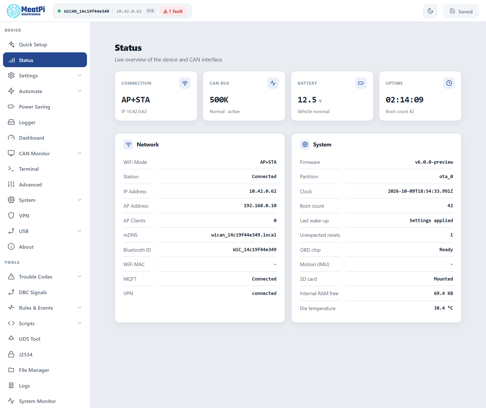

# Faults

A fault is the device's own trouble code: a structural problem, latched with a code, a detail, a count and the time it was first and last seen. It survives restarts and power cycles until someone clears it, so a problem that happened once in the field is still visible on the bench weeks later.

## Where faults show

A red chip in the header, `1 fault`, next to the device name: click it for the list. ==System Monitor== › ==Fault codes== lists them with their details; `GET /api/faults` returns them ([Device](../reference/http-api/device.md)).

<figure class="shot" markdown>
{ width="640" }
<figcaption>A device carrying one latched fault.</figcaption>
</figure>

## The codes

| Code | What it means | What to do |
| --- | --- | --- |
| `boot_errors` | Error lines were logged while the device started; the detail counts them. Something did not start as it should: a file it could not read, a card it could not mount, a component that fell back to defaults. | read the start of the log (==Logs==); fix the cause; clear the fault. A device updated from the v4.5x firmware carries one from the boots before its partition layout was rewritten; that one is dropped by itself. |
| `registry_headroom` | An internal table is within two entries of full: connection rows, rules, routes, settings components. The detail names it. | remove rows you do not use; report it |
| `boot_flash_budget` | More than 64 flash erases during one start: the settings were rewritten wholesale (a corrupt settings file replaced by defaults, a migration). | once after an update is expected; repeated, report it |
| `flash_churn` | Flash erases kept rising for ten minutes in a row while the device ran: something writes continuously. | find the writer (a logger pointed at internal flash, a script); report it |
| `internal_ram_low` | The internal heap dropped under 8 KB free, or its lowest value under 4 KB. Below that Bluetooth and the web server misbehave without an error of their own. | fewer features at once (Bluetooth, VPN, the CAN monitor stream, a logger); report it with the System Monitor figures |
| `logger_file_corrupt` | A log file could not be read back; it was set aside as `<name>.corrupt` and logging went on in a fresh file. | copy the `.corrupt` file off the card if it matters, then delete it |

## Clear

The chip's list has a ==Clear== button (`POST /api/faults/clear`); the console command is `faults -c`. Clearing forgets the record only: a fault whose cause is still there comes back on the next start. Safe mode's factory reset wipes them with the key-value store they live in; the web interface's factory reset keeps them.

## How they are kept

Sixteen slots in the device's key-value store, written once when a code first appears and at most once per boot when it repeats, so the fault store can never become the flash-wear problem it guards against. Counts between those writes are kept in RAM.
