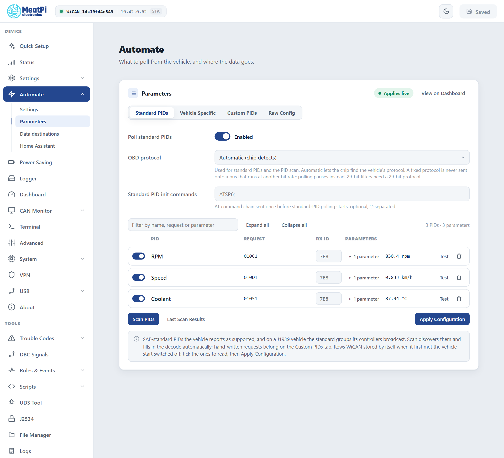
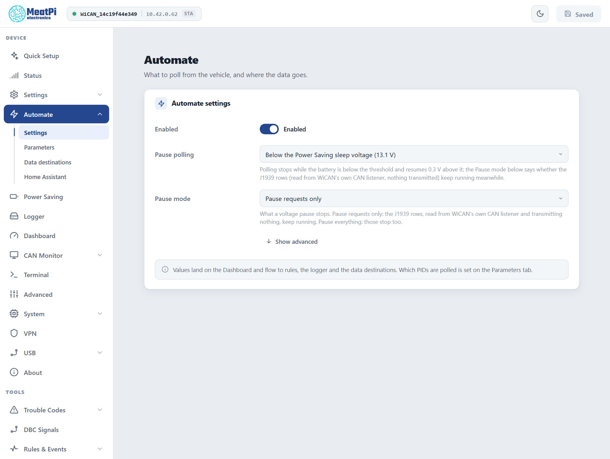

# AutoPID

Facts checked against the device's settings schema and the firmware's API reference, firmware v6.00p_alfa-02, 2026-10-09. Screens from the web interface preview.

AutoPID is the loop that asks your car for values and turns the answers into named parameters: RPM, speed, coolant temperature, state of charge. Everything else in WiCAN (the Dashboard, Home Assistant, MQTT, the logger, the rules) works from those parameters. The web interface calls the whole area ==Automate==.

## What it does

Every polling round WiCAN sends one request per enabled parameter to the car, decodes each reply with an expression, and publishes the value. Where a value comes from decides which tab it lives on:

| Tab | Rows | Where they come from |
| --- | --- | --- |
| ==Standard PIDs== | the OBD-II values every car must answer, as far as yours supports them | detected by the scan, decoded by WiCAN's built-in table |
| ==Vehicle Specific== | the values only your make and model carry, such as battery state of charge | a vehicle profile from the MeatPi profile list |
| ==Custom PIDs== | requests you write yourself, with your own decoding | you |
| ==Raw Config== | the same tables as one JSON document | for copying between devices and for the adventurous |

All rows belong to the current vehicle. WiCAN keeps up to 8 vehicles, each with its own protocol, rows and profile, and switches when another known car answers.

<figure class="shot" markdown>
{ width="640" }
<figcaption>Three standard PIDs polled from the car, each with its live value. Apply Configuration applies the tables at once, no restart.</figcaption>
</figure>

## The Parameters page

==Automate== › ==Parameters==. Changes on this page apply live when you press ==Apply Configuration==: no restart.

**Standard PIDs**

- ==Poll standard PIDs== switches the whole tab on or off.
- ==OBD protocol==: ==Automatic== lets the OBD chip find the car's protocol; or pin one of the four CAN variants (11-bit or 29-bit ids, 500 or 250 kbit/s). A pinned protocol is never sent onto a bus that runs at another bit rate: polling pauses instead.
- ==Standard PID init commands==: an optional chain of AT commands sent once before standard polling starts, separated by `;`.
- The rows: a switch, the name, the request, the responding ECU id, the parameters with their live values, ==Test== (sends that one request now and shows the raw reply and the decoded value), delete.
- ==Scan PIDs== runs the detection again; ==Last Scan Results== shows what the car answered. Rows WiCAN stored by itself when it first met the vehicle start switched off: tick the ones to read, then ==Apply Configuration==.

**Vehicle Specific**: the profile chosen for this car and its rows. A profile is picked in Quick Setup or here; it is saved under the car and applied again whenever that car answers. See [Vehicle profiles](vehicle-profiles.md).

**Custom PIDs**: your own rows. A row is a request (`221E3B`, `0105`), an optional init chain sent before it, an optional expected response id, and one or more parameters, each with a name, an expression over the reply bytes (`B0`, `B1`, ... and `[B2:B3]` for a 16-bit value), a unit and a class. Rows sit in groups; a group has a period, so slow values can be asked less often than fast ones.

**Raw Config**: the tables as JSON, the same document `GET /api/autopid/config` returns. Paste one from another device or a profile and apply.

## The Automate settings

==Automate== › ==Settings==, applied from ==Submit== in the header.

<figure class="shot" markdown>
{ width="640" }
<figcaption>The defaults after Quick Setup: polling pauses with Power Saving and resumes 0.3 V above the threshold.</figcaption>
</figure>

| Setting | Meaning |
| --- | --- |
| ==Enabled== | The loop runs at all. Off on a new device until Quick Setup or you turn it on. |
| ==Pause polling== | ==Below the Power Saving sleep voltage== (the usual choice: the car's modules can sleep when the car is parked), below a voltage you choose, or never. Polling resumes 0.3 V above the threshold. |
| ==Pause mode== | ==Pause requests only== keeps the J1939 rows running during a pause, because they only listen and transmit nothing. ==Pause everything== stops them too. |
| ==Report a change at most every== (advanced) | How fast value changes are pushed to Home Assistant, MQTT and the rules. 1 second by default. |

## When polling pauses, and why

The Dashboard header and `GET /api/autopid` say when the loop is not running and why:

| Reason | What happened |
| --- | --- |
| paused, voltage | the battery is below the pause voltage |
| paused, client | an app (Car Scanner, Torque, a BLE app) is talking to the OBD chip through a bridge. The loop yields and resumes 10 seconds after the app's last command. |
| paused, diagnostics | the UDS Tool, a script or a J2534 tester holds the bus |
| parked by the bus guard | the vehicle bus runs at another bit rate than the protocol in use, so nothing is sent. WiCAN listens to the bus before it lets the chip talk; a wrong bit rate would disturb the car. |

## Timing

The OBD chip needs about 53 ms per request. Three parameters every second are comfortable; thirty parameters every second are not, and the Parameters page warns when a group's period is below what the chip can do. Quick Setup's ==Every 5 seconds== is plenty for a home dashboard; ==Every second== is for live driving data.

## Where the values go

- The [Dashboard](../getting-started/web-interface.md#dashboard): one tile per parameter, a sparkline, the age of the value.
- [Home Assistant](../send-data/home-assistant.md): one entity per parameter, pushed every few seconds.
- [MQTT](../send-data/mqtt.md) and [Data destinations](../send-data/data-destinations.md): the snapshot of all values, on a cycle.
- The [Data logger](data-logger.md): every value, or only changes, to the SD card.
- [Automate rules](../tools/automate-rules.md): `autopid.param` events to react to, `${autopid.<name>}` values to read.
- Scripts and the API: `GET /api/autopid/data` is the flat snapshot `{"RPM": 848.5, "Speed": 0.45, ...}`.

## Troubleshooting

- **No values at all**: the ignition must be on; check ==Enabled== on the Automate settings and the pause reason on the Dashboard header; on a new car run ==Scan PIDs==.
- **A row never answers**: ==Test== it. The transcript shows every exchange, including the init chain and the raw reply, which is the quickest way to see a wrong request or a wrong responding id.
- **Values stop when an app connects**: expected. The loop yields to the app and resumes 10 seconds after its last command.
- **Rows exist but are switched off**: WiCAN stored what the car answered when it first met it and reads nothing until you choose. Tick and ==Apply Configuration==.

The routes behind this page are on [Vehicle](../reference/http-api/vehicle.md#autopid) in the API reference.
