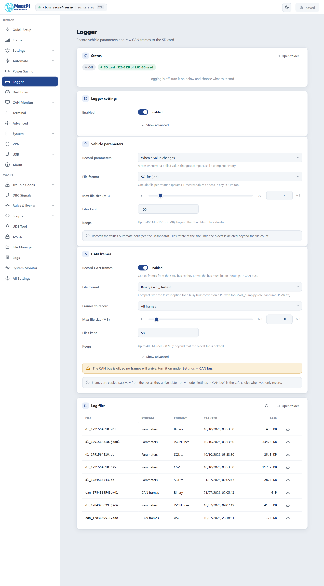

# Data logger

WiCAN PRO records to the SD card: the vehicle parameters it polls, and raw CAN frames, each in the file format your tools open. SQLite, CSV and JSON lines for the parameters; for frames also MDF4, Vector BLF, candump and ASC. Files rotate by size, the oldest go when the count is reached, and the Dashboard reads its history from them.

## Before you start

An SD card in the slot, formatted FAT (as cards come). The ==Logger== page's status chip reads `SD card · used of total` once the card is mounted. WiCAN never formats a card: an unreadable one stays unmounted and the chip says so. Files land in `/sd/logs`.

<figure class="shot" markdown>
{ width="640" }
<figcaption>Logger, with both streams switched on. Changes apply from Submit in the header.</figcaption>
</figure>

## Vehicle parameters

The values AutoPID polls, as they arrive. A parameter is stored as `autopid.<name>`.

<dl class="facts" markdown>
<dt>Record parameters</dt><dd>==Off==, ==When a value changes== (a row whenever a polled value differs from the last one: compact, still a complete history) or ==Every poll==.</dd>
<dt>File format</dt><dd>==SQLite (.db)==, the default: one file per rotation with `params` and `records` tables, opens in any SQLite tool. ==CSV (.csv)==: `ts_ms,source.name,value`. ==JSON lines (.jsonl)==: one object per line. ==Binary (.wdl)==: the compact format, converted on a PC.</dd>
<dt>Max file size, Files kept</dt><dd>1 to 32 MB (4) and 1 to 500 files (100): the page works out what the card keeps at most.</dd>
</dl>

To record only some parameters, or any value an event carries, leave ==Record parameters== off and use a rule: `autopid.param` matching the parameter, action ==Logger write== ([Automate rules](../tools/automate-rules.md)).

## CAN frames

Every frame on the bus, or those matching an id, copied as they arrive. The CAN interface must be on (==Settings== › ==CAN bus==) at the bus's bit rate or ==Automatic==; ==Listen-only== is the right choice when you only record.

<dl class="facts" markdown>
<dt>Record CAN frames</dt><dd>The switch of the stream.</dd>
<dt>File format</dt><dd>==Binary (.wdl)==, the default and the fastest: the one for a busy bus. ==MDF4 (.mf4)== (ASAM, for asammdf, CANoe, MATLAB), ==BLF (.blf)== (Vector), ==candump (.log)== (SocketCAN text, for can-utils replay and SavvyCAN), ==ASC (.asc)== (CANalyzer text), ==CSV== (`ts_ms,id,ext,rtr,dlc,data`), ==JSON lines==, ==SQLite== (slow: only for a filtered or quiet bus).</dd>
<dt>Frames to record</dt><dd>==All frames==, or the ids matching a filter and mask, 11 or 29 bit; the page spells out the id range that matches.</dd>
<dt>Max file size, Files kept</dt><dd>1 to 128 MB (8) and 1 to 500 files (50).</dd>
</dl>

MDF4, BLF and ASC files start fresh at every restart and rotation; they are never appended across boots. A `.wdl` file is converted with `tools/wdl_dump.py` from the firmware repository: `--to csv`, `candump`, `trc` (PEAK) or `text`.

## The files

| Name | Stream |
| --- | --- |
| `dl_<time>.<ext>` | parameters |
| `can_<time>.<ext>` | CAN frames |

`<time>` is the start time in seconds since 1970, so names sort by age. A file is closed at its size limit and a new one starts; beyond the file count the oldest of that stream is deleted. The list at the bottom of the Logger page shows the newest files with a download button; ==Open folder== goes to the [File Manager](../tools/files.md) at `/sd/logs`.

!!! note "The file being written is locked"
    Downloading or deleting the active file of a stream fails with `file in use`, on purpose: a file removed while it is written leaves orphaned clusters on the card. Press ==Pause== on the page (both streams close their files) or wait for the rotation, then download. Rotated files are always free.

## Pause, and rules

- ==Pause== on the Logger page stops both streams until ==Resume== or the next restart; the settings stay. Records keep queueing while paused, so a resume also lands the newest ones from just before.
- A rule can do the same with the actions ==Logger enable== and ==Logger disable==: log only while driving, start on a trouble code, stop below a battery voltage.
- The events `logger.rotated` (with the file name) and `logger.error` can trigger a rule too: upload a file when it rotates, say.

## The Dashboard reads the files

A chart tile on the Dashboard backfills its parameter's history from the recorded files (windows of 15 minutes to 6 hours) and continues live, in any of the four parameter formats. With the logger off, or ==Record parameters== off, the tile says so and links here.

## Power cuts and crashes

Records are gathered in memory and written in batches every 5 seconds (==Show advanced==: the flush interval, the batch size and the queue length). A power cut loses the last few seconds at most; SQLite commits are atomic, text and binary files get a torn tail trimmed when logging resumes. A file WiCAN cannot read back is set aside as `<name>.corrupt` with a fault on the Status page, and logging goes on in a fresh file. Planned restarts and sleep close the files first.

## Timestamps

Every row carries the time it was taken, in UTC, as milliseconds since 1970 (the `ts` or `ts_ms` column; the `(sec.usec)` stamp of candump). WiCAN keeps its clock in UTC everywhere: the battery-backed clock chip restores it seconds after power-on, an internet time sync corrects it whenever a network comes up, and ==Settings== › ==Clock== can set it by hand. Your tools convert to local time; nothing on the device does.

The clock can still move while WiCAN records: the first sync after a long time unpowered moves it from 1970 to today, a sync after weeks without one corrects the chip's drift by seconds, a manual set moves it by whatever you typed. What happens to the rows:

- A row queued just before a correction is written with the corrected time.
- MDF4, BLF and ASC files measure their time from the moment the file started and never run backwards; MDF4 and BLF carry the corrected start in their header.
- When the clock becomes valid, or moves by a minute or more, both streams close their files and start new ones: a file is consistent within a minute from end to end.
- The device writes down what its clock did in `/sd/logs/clock.jsonl`, the **clock journal**: one line when a boot starts (whether the clock was set), one for every time it was set (how far it moved, which files were open), one for every file closed because of it. ==Clock journal== on the Logger page downloads it. JSON lines, CSV, binary and SQLite files also carry a marker where the clock moved inside them.

The Logger page's status says how the clock was set and whether it moved this boot; the file list says `clock not set until ...` for a file written before the first sync, or `clock moved +2 h` for one the clock moved under. The Dashboard reads the journal and places history points at their corrected times.

A file recorded before a correction can be re-based on a PC with the journal and `tools/log_clock.py` from the firmware repository: `python log_clock.py --journal clock.jsonl --rebase dl_1791890598.wdl` writes `dl_1791890598.rebased.wdl` with every row moved by the corrections that came after it (JSON lines, CSV, candump and binary files); `--show clock.jsonl` prints the journal as a table. Rows written on a WiCAN that never gets a time sync stay at 1970 plus the time since boot; the journal's boot lines tell them apart per boot.

## Troubleshooting

| Symptom | Likely cause | What to do |
| --- | --- | --- |
| `Waiting for storage` | no card, or a card WiCAN cannot read | seat the card; format it FAT on a PC |
| Recording, but no parameter rows | ==Record parameters== off, polling off or paused, ignition off | ==When a value changes==; ==Automate== › ==Settings==; ignition on |
| An empty CAN file | the CAN interface is off or at the wrong bit rate | ==Settings== › ==CAN bus== › ==Enabled==, ==Automatic== |
| Download answers `file in use` | the active file | ==Pause==, download, ==Resume== |
| `dropped` or `frames_dropped` grows | the card cannot keep up with the rate | ==Binary (.wdl)== for frames, a filter, a faster card |
| Timestamps in 1970, `clock not set` in the file list | the clock was not set when the file started (no network, the clock chip's backup drained) | a time source (WiFi, or set the clock by hand under ==Settings== › ==Clock==); re-base the file with the clock journal and `tools/log_clock.py` |
| Rows jump by hours inside one file, or the file list says `clock moved` | the clock was corrected while the file was open | the rows after the marker are right; re-base the ones before with the clock journal |
