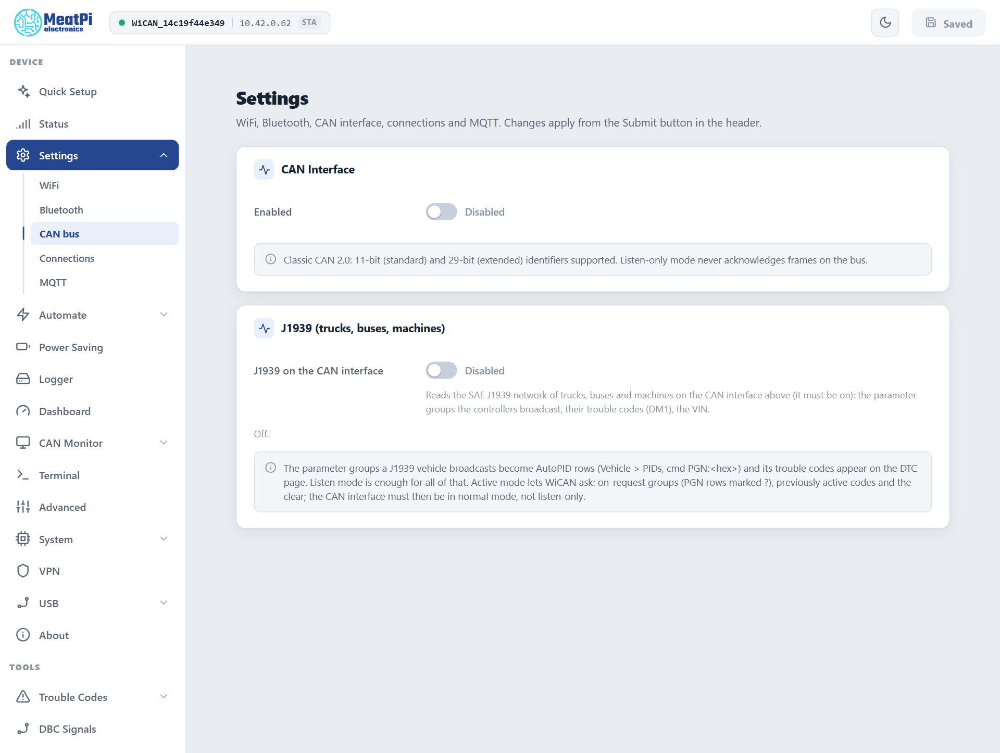
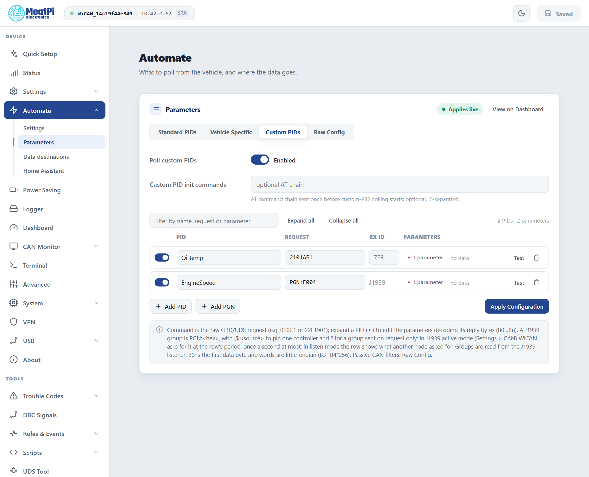

# J1939 and WWH-OBD

<p class="verified pending">Settings, defaults and the status document read from the bench device (an OBD-II car on the bench, the listener off), firmware v6.00p_alfa-02, 2026-10-10; the pages from the web interface preview; behaviours from the firmware's J1939 and AutoPID references. The firmware's own benches cover a J1939 network and an EU truck; nothing of that was re-run for this page.</p>

<p class="lead">Trucks, buses, agricultural and construction machines do not talk like a car. Their controllers broadcast what they know on the CAN bus (SAE J1939), and their legislated emission data is asked over UDS (WWH-OBD, ISO 27145). WiCAN Pro listens to the first and asks the second; a European truck has both on one bus, and WiCAN handles both at once.</p>

## Which is which

| | OBD-II (a car) | WWH-OBD, OBD on UDS | SAE J1939 |
| --- | --- | --- | --- |
| Who | Passenger cars and light vehicles | EU heavy-duty vehicles and vans (ISO 27145); US cars from model year 2027 (SAE J1979-2) | Trucks, buses, agricultural and construction machines |
| How the data moves | WiCAN asks, the ECU answers (`010C` for engine speed) | WiCAN asks over UDS (`22F40C` for the same value) | The controllers broadcast on their own; nobody has to ask |
| What WiCAN uses | The OBD chip | The OBD chip | Its own CAN interface, listening |
| Set up by | Quick Setup's vehicle step, or ==Scan PIDs== | The same: WiCAN finds that `22F400` answers where `0100` is silent | Quick Setup's vehicle step hears the network, or ==Settings== › ==CAN bus== by hand |

## J1939: listening to the network

### Switch the listener on

Quick Setup does this for you: its vehicle step listens to the network when no OBD answer comes, reports `J1939 vehicle` with the bit rate it measured, and stages the CAN interface and the listener in the one restart it asks for. By hand:

<div class="steps" markdown>

1.  **==Settings== › ==CAN bus== › ==CAN Interface== › ==Enabled==**

    ==Bit rate== ==Automatic== lets WiCAN measure the bus (most J1939 networks run at 250 kbit/s, some at 500). Keep ==Listen-only (silent) mode== on: WiCAN never acknowledges or sends a frame on the vehicle's network.

2.  **==J1939 (trucks, buses, machines)== › ==J1939 on the CAN interface==**

3.  **==Submit==** in the header. WiCAN restarts and starts listening.

</div>

<figure class="shot" markdown>
{ width="640" }
<figcaption>Settings, CAN bus: the CAN interface and the J1939 listener.</figcaption>
</figure>

### What it hears

- **Parameter groups** (PGNs): the newest message of every group from every controller, long messages reassembled. Groups a controller only sends on request appear when some other node of the vehicle asks for them (an instrument cluster usually does).
- **The VIN**, when a controller broadcasts it (PGN 65260).
- **Active trouble codes** (DM1) of every controller, with the four lamps.
- **Who is on the bus**: each source address, its frame count and, when it claimed its address, its NAME.

The status is `GET /api/j1939` ([Vehicle](../reference/http-api/vehicle.md)): the state (`off`, `no_bus` when the CAN interface is off, `listening`), the bus verdict (`j1939` once two well-known groups were seen, `other` after 50 frames without one), sources, values and DM1. The Parameters page shows a listener line over the table with the same facts.

### Values on the Dashboard: PGN rows

A J1939 value is an ordinary parameter row whose request names a group instead of a PID. ==Automate== › ==Parameters== › ==Custom PIDs== › ==Add PGN== adds one (`PGN:F004`, engine speed); the row shows a `J1939` tag where an RX ID would be, and ==Test== decodes it from what the listener holds.

```text
PGN:F004          engine controller 1, from whichever controller sends it
PGN:FEEE@0        engine temperature from source address 0 (the engine)
PGN:FEE5?         engine hours: a group only sent on request
```

<dl class="facts" markdown>
<dt>PGN:&lt;hex&gt;</dt><dd>The group number, 1 to 5 hex digits.</dd>
<dt>@&lt;source&gt;</dt><dd>Pins one controller (0 to 253). Without it WiCAN takes the lowest address heard in the last 5 seconds, so the engine wins over a trailer.</dd>
<dt>?</dt><dd>A group sent on request only. In listen mode the row shows what another node asked for; in active mode (below) WiCAN asks at the row's period, once a second at most.</dd>
<dt>Expressions</dt><dd>`B0` is the first data byte. J1939 words are little-endian, so compose them byte by byte: `B3+B4*256`, not `[B3:B4]`.</dd>
</dl>

<figure class="shot" markdown>
{ width="640" }
<figcaption>Automate, Parameters, Custom PIDs: a PGN row beside an ordinary request.</figcaption>
</figure>

WiCAN knows 21 common values by name, so a row for one of these needs no expression of its own and Quick Setup offers them as the standard set of a J1939 vehicle:

| Name | SPN | Group | Unit |
| --- | --- | --- | --- |
| EngineSpeed, ActualEnginePercentTorque | 190, 513 | F004 | rpm, % |
| AccelPedalPosition1, EnginePercentLoad | 91, 92 | F003 | % |
| TransCurrentGear | 523 | F005 | |
| WheelBasedVehicleSpeed | 84 | FEF1 | km/h |
| EngineCoolantTemperature, EngineOilTemperature | 110, 175 | FEEE | degC |
| EngineOilPressure | 100 | FEEF | kPa |
| IntakeManifoldPressure, IntakeManifoldTemperature | 102, 105 | FEF6 | kPa, degC |
| BarometricPressure, AmbientAirTemperature | 108, 171 | FEF5 | kPa, degC |
| BatteryPotential | 168 | FEF7 | V |
| FuelRate | 183 | FEF2 | L/h |
| FuelLevel1 | 96 | FEFC | % |
| DEFTankLevel | 1761 | FE56 | % |
| TotalVehicleDistanceHR | 917 | FEC1 | km |
| TotalVehicleDistance | 245 | FEE0 (on request) | km |
| EngineTotalHours | 247 | FEE5 (on request) | hours |
| EngineTotalFuelUsed | 250 | FEE9 (on request) | L |

Everything else comes from a DBC file (==DBC Signals==) or a PGN row with your own expression.

!!! note "Not available is not a value"
    J1939 reserves the top of every range: `FF` means the controller has no such parameter, `FE` that it cannot measure it right now, `FB` a special meaning (a gear selector in park). WiCAN reports those states and publishes no value for them, so a dashboard never shows 255 degrees.

### Trouble codes on a J1939 vehicle

==Trouble Codes== shows the active codes every controller broadcasts (DM1): `SPN110-0` form, the occurrence count, the source address in the ECU column, and the four lamps (MIL, Stop, Warning, Protect) as chips. A listener clears nothing, so the page offers no clear on a J1939-only vehicle. See [Trouble codes](trouble-codes.md).

## Active mode: when WiCAN must ask

Listening covers nearly everything. Active mode makes WiCAN a node of the network: it claims an address (249 by default, the first off-board diagnostic tool address, moving to another one when a controller contests it), answers requests addressed to it, and can ask:

- the groups sent on request (`?` rows: engine hours, total distance, fuel used) at the row's period;
- the VIN during vehicle detection;
- previously active codes (DM2) for the Trouble Codes report, and the clears (DM11, DM3) when clearing is allowed.

Under ==Settings== › ==CAN bus== › ==J1939== › ==Show advanced==: ==Mode== ==Active== and the ==Preferred address==. The CAN interface must then run in normal mode (==Listen-only== off), because a node has to acknowledge frames. Use it when a value you need is only sent on request; on a vehicle you merely want to watch, stay in listen mode.

## WWH-OBD and OBD on UDS

Nothing to set. Vehicle detection asks `0100` and `22F400`; the one that answers decides the dialect, and WiCAN remembers it with the car. From then on:

- **Standard PIDs** are `22F4xx` requests. Each row carries the ECU that owns the value (`22F40C · ECU 58` on the Parameters page), because the same PID can come from several ECUs on such a vehicle.
- **The VIN** is read with `22F802` (or `22F190`).
- **Trouble Codes** shows the path `OBD on UDS (ISO 27145)`: confirmed and pending codes, permanent codes, every ECU parsed apart. The legislated clear wipes the emission codes of every ECU, like mode 04 on a car.
- **Profiles** work as on any car; standard and vehicle-specific rows can mix.

An EU truck answers WWH-OBD and broadcasts J1939 on the same bus: its record carries the UDS dialect and the J1939 flag, its table holds `22F4xx` rows beside `PGN:` rows, and its DTC report lists the UDS codes with the DM1 codes. Quick Setup adds a `J1939 network as well` note when it finds one.

## Troubleshooting

| Symptom | Likely cause | What to do |
| --- | --- | --- |
| State `no_bus` | the CAN interface is off | ==Settings== › ==CAN bus== › ==Enabled==, ==Submit== |
| Bus verdict `other` | not a J1939 network, or the wrong bit rate | ==Bit rate== ==Automatic==; check the connector carries the J1939 bus (some vehicles have it on other pins than the diagnostic CAN) |
| No sources, no values | the network is quiet: ignition off | ignition on; many controllers only broadcast with the engine running |
| A `?` row never updates | listen mode, and nobody else asks for that group | active mode, or drop the row |
| Values freeze for a while and resume | the controller stopped broadcasting; WiCAN keeps the last value and marks its age | nothing |
| `queue_drops` grows in the status | the bus is busier than the listener's queue in bursts | normal on a loaded bus; the stored messages are still the newest |
