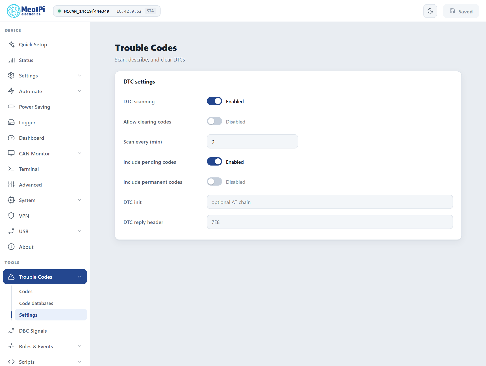
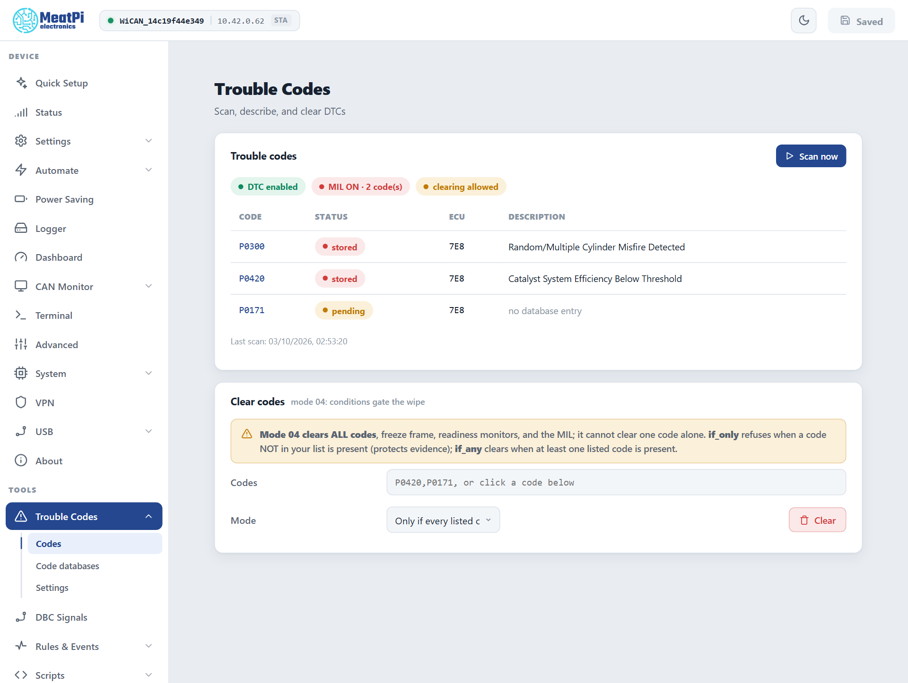
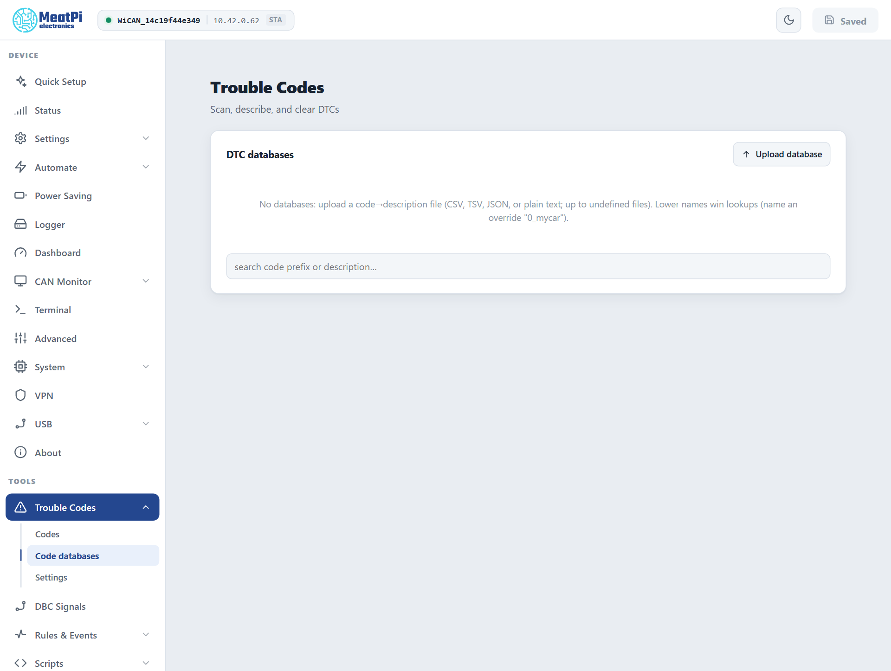

# Trouble codes

The gates, the report shape and the database list read from the bench device (scanning is off there and no scan was run for this page), firmware v6.00p_alfa-02, 2026-10-10. The pages from the web interface preview with a sample report. The firmware's own benches cover scans and clears against the ECU simulator.

WiCAN reads the diagnostic trouble codes (DTCs) your car's ECUs store, shows them with descriptions from a code database you upload, and clears them when you say so. Scans can run on a schedule, and a new code can trigger a rule: an LED, an MQTT message, a push to Home Assistant.

Everything is under ==Trouble Codes== in the sidebar: ==Codes==, ==Code databases== and ==Settings==.

## Two switches, both off out of the box

Scanning and clearing are each behind a switch on ==Trouble Codes== › ==Settings==, applied from ==Submit== (WiCAN restarts):

- ==DTC scanning== allows scans, by hand or on a schedule.
- ==Allow clearing codes== allows the ==Clear== button on top of that. Leave it off on a car you only want to watch.

Scanning works with vehicle polling off: it only needs the OBD chip and the ignition on.

<figure class="shot" markdown>
{ width="640" }
<figcaption>Trouble Codes, Settings, with scanning on and clearing still locked.</figcaption>
</figure>

## Scan

Ignition on, then ==Scan now== on ==Trouble Codes== › ==Codes==. Right after WiCAN starts the chip needs about 15 seconds before a scan can answer. The table lists one row per code and ECU:

| Column | Meaning |
| --- | --- |
| Code | `P0420`, `C1234`, `B0001`, `U0100`: powertrain, chassis, body, network |
| Status | `stored` (confirmed, the lamp may be on), `pending` (seen once, not yet confirmed), `permanent` (cleared only by the ECU itself once the fault stays away), and `new` for a code that was not in the previous scan |
| ECU | which module reported it, when more than one answered |
| Description | from your uploaded databases, `no database entry` otherwise |

Above the table: the lamp (MIL) state and how many codes the ECU counts, and a chip naming the path the scan took.

<figure class="shot" markdown>
{ width="640" }
<figcaption>Trouble Codes, Codes, after a scan on an OBD-II car (preview with a sample report).</figcaption>
</figure>

**What a scan asks** depends on the car:

- An OBD-II car: the stored codes (mode 03), the pending ones when ==Include pending codes== is on (mode 07), the permanent ones when ==Include permanent codes== is on (mode 0A), and the lamp state (mode 01).
- A car that speaks OBD over UDS (ISO 27145, the WWH-OBD of newer vehicles): the equivalent services, every ECU parsed apart; the page says `OBD on UDS (ISO 27145)`.
- A J1939 truck or machine: the active codes its controllers broadcast (DM1), with source address, occurrence count and the four lamps. WiCAN only listens there; the page offers no clear on a J1939-only vehicle.

**On a schedule.** ==Scan every (min)== runs a scan periodically (`0` = only when you press the button). Each code that is new since the last scan raises the event `autopid.dtc` with the code, its status and the lamp state, so a rule under ==Rules & Events== can act on it ([Automate rules](../tools/automate-rules.md)). Scripts can call `dtc_scan()` and `dtc_clear()` as well.

## Clear

Clearing on an OBD-II car is mode 04, and mode 04 is all or nothing: it wipes every emission code of every ECU, the freeze frame, the readiness monitors and the lamp. It cannot remove one code. Permanent codes survive by design. On a WWH-OBD car the matching service clears all emission codes of every ECU too.

Because of that the ==Clear codes== section has a condition:

| Mode | What happens |
| --- | --- |
| ==Only if every listed code is present== (`if_only`) | Refuses when a code that is not in your list is present. Protects evidence you have not looked at yet. |
| ==If any listed code is present== (`if_any`) | Clears when at least one of the listed codes is present. |
| ==Always== | Clears whatever is there. |

Type the codes (`P0420,P0171`) or click them in the table, choose the mode, ==Clear==. WiCAN reads the codes fresh, applies the condition, clears, and reads again to confirm. The button stays grey until ==Allow clearing codes== is on.

## Code databases

WiCAN ships without code descriptions; the table shows `no database entry` until you upload a list. ==Trouble Codes== › ==Code databases== › ==Upload database== takes up to 8 files, the format detected on upload:

- CSV, TSV or semicolon-separated, with or without a header line and quotes: `P0420,Catalyst System Efficiency Below Threshold`
- A JSON object: `{"P0420": "Catalyst System Efficiency Below Threshold"}`
- A JSON array of objects with `code` and `description` keys (common aliases accepted)
- Plain text: the code, a space, the description

Codes with a suffix (`P0420-00`) are stored as the bare code. A rejected line is named in the error. When two databases describe the same code, the one whose name sorts first wins: name a personal override `0_mycar` to put it ahead of a generic list. The search box on the page looks up a code prefix or a word of the description across all databases.

<figure class="shot" markdown>
{ width="640" }
<figcaption>Trouble Codes, Code databases, before any upload.</figcaption>
</figure>

## Settings reference

<dl class="facts" markdown>
<dt>DTC scanning</dt><dd>Off by default. Scans by hand and on a schedule.</dd>
<dt>Allow clearing codes</dt><dd>Off by default. The second gate, for ==Clear==.</dd>
<dt>Scan every (min)</dt><dd>`0` by default: on demand only.</dd>
<dt>Include pending codes</dt><dd>Mode 07 in every scan.</dd>
<dt>Include permanent codes</dt><dd>Mode 0A in every scan.</dd>
<dt>DTC init</dt><dd>AT commands sent to the chip before each scan, `;` separated. Usually empty.</dd>
<dt>DTC reply header</dt><dd>Listen to one ECU only (`7E8` for the engine ECU). Empty: every ECU that answers.</dd>
</dl>

Under ==All Settings== › ==AutoPID== the transport can be pinned: `dtc_protocol` (`auto` tries OBD first and UDS second), the UDS request and reply ids (`7E0`, `7E8`), 29-bit ids and the UDS status mask.

## Troubleshooting

| Symptom | Likely cause | What to do |
| --- | --- | --- |
| ==Scan now== is grey, `DTC disabled` | the first switch is off | ==Trouble Codes== › ==Settings== › ==DTC scanning==, then ==Submit== |
| The scan returns nothing right after a start | the chip is not ready yet | wait 15 seconds and scan again |
| `busy` when scanning | another chip job is running (vehicle detection, a PID test) or an app holds the chip | wait for it, or close the app |
| ==Clear== is grey, `clearing locked` | the second switch is off | ==Allow clearing codes==, then ==Submit== |
| The clear was refused | the `if_only` condition met a code not in your list | look at that code first, or use `if_any` |
| A code comes back after clearing | the fault is still present, or it was a permanent code | fix the fault; permanent codes clear themselves later |
| No descriptions | no database uploaded, or the code is not in it | upload one under ==Code databases== |
