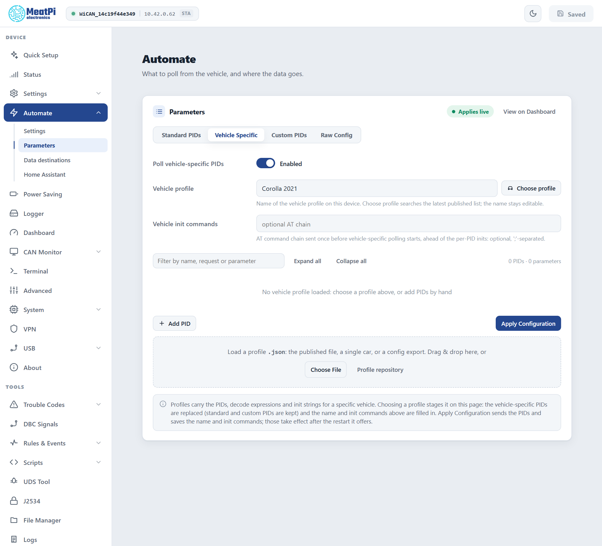
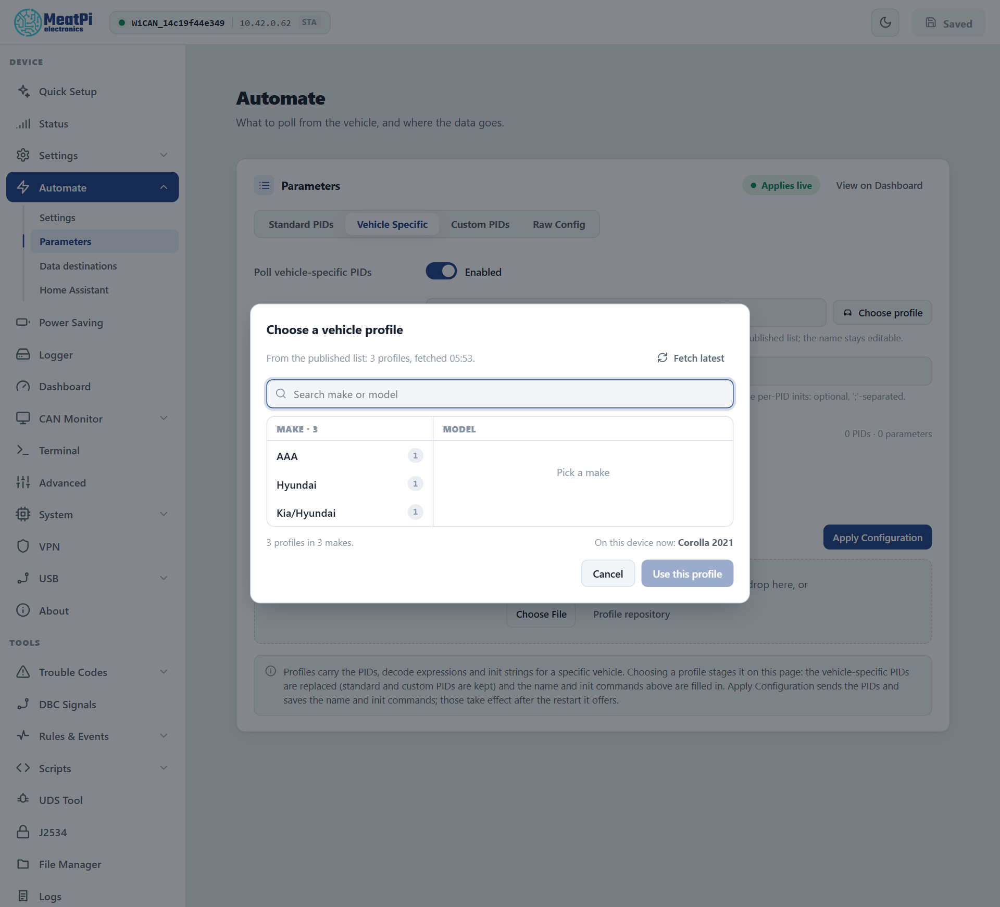
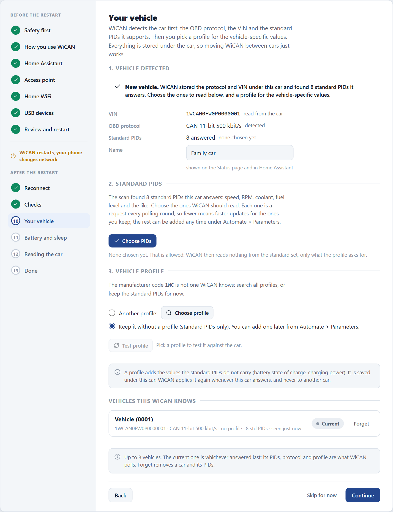

# Vehicle profiles

<p class="lead">A vehicle profile is a ready-made set of requests for one car model: battery state of charge, cell voltages, charging state, cabin temperature, the things standard OBD does not expose. Profiles are shared by the community in the WiCAN repository and loaded from the web interface. Combustion cars mostly get by on the standard PIDs; EVs and hybrids want a profile.</p>

## Where profiles appear

The cars that have a profile today are listed on [Supported vehicles](../supported-vehicles.md), generated from the profile sources at every publish.

- **Quick Setup**, on the vehicle step: after ==Detect my vehicle== the step suggests profiles for the detected car, lets you ==Test profile== before choosing, or keep the car without one.
- **==Automate== › ==Parameters== › ==Vehicle Specific==** on a device that is set up: the ==Vehicle profile== row names the profile the device runs, ==Choose profile== opens the published list, and a drop zone takes a profile file.

<figure class="shot" markdown>
{ width="640" }
<figcaption>Automate, Parameters, Vehicle Specific, before a profile is loaded.</figcaption>
</figure>

## Choose a profile

<div class="steps" markdown>

1.  **Open the list**

    ==Automate== › ==Parameters== › ==Vehicle Specific== › ==Choose profile==. The dialog fetches the latest published list (==Fetch latest== reads it again). Makes are on the left, the chosen make's models on the right; the search box looks through both and picks a single match by itself. The car the device runs now is preselected.

2.  **==Use this profile==**

    Nothing is sent yet. The profile's PIDs replace the vehicle-specific rows on the page (standard and custom rows are kept), and the ==Vehicle profile== name and ==Vehicle init commands== are filled in. The page shows an `Unsaved edits` chip and a banner with ==Discard==.

3.  **Test a row (optional)**

    Each PID row has ==Test==: with the ignition on, WiCAN sends that one request and shows the exchange (what was sent, what came back), the payload and every decoded parameter. A negative response or `NO DATA` is visible here before anything is saved.

4.  **==Apply Configuration==**

    The PIDs go to the device and take effect at once; the name and init commands are saved with the settings and take effect after the restart the page offers.

</div>

<figure class="shot" markdown>
{ width="640" }
<figcaption>The profile picker over the published list.</figcaption>
</figure>

**From a file.** Drop a `.json` file on the dashed zone, or ==Choose File==. The file can be the whole published list, a single car, or a configuration exported from a WiCAN (the ==Raw Config== tab). ==Profile repository== opens the repository the list is generated from.

!!! tip "A profile that switches protocol"
    Some profiles start with commands that move the OBD chip to another protocol or header (an init with `ATSP7` or `ATSH...`). If standard PIDs are polled as well, give them a way back: under ==Standard PIDs== set ==Standard PID init commands== to something like `ATSP6;ATSH7DF;ATCRA;ATH0` so each set re-establishes its own world before polling.

## During Quick Setup

The vehicle step detects the car first (protocol, VIN, the standard PIDs it supports), then offers profiles. ==Test profile== sends every request of a profile once and shows each parameter with its value; ==Use this profile== picks it, ==keep it without a profile== is a fine answer for a car that only needs standard PIDs. A car saved without a profile is listed as `Profile pending` until you give it one.

<figure class="shot" markdown>
{ width="640" }
<figcaption>Quick Setup, the vehicle step after detection.</figcaption>
</figure>

## The cars WiCAN remembers

WiCAN keeps a record of up to 8 vehicles, each with its protocol, its tables (standard, vehicle-specific and custom PIDs) and its profile. A car is recognised by its VIN, or by the set of ECUs that answered when it has no readable VIN.

- **At every start**, after the first successful poll, WiCAN checks which car it is on. The current car: nothing changes. Another remembered car: its tables are loaded live. An unknown car: detection runs and a new record is made, its standard PIDs stored switched off until you tick the ones to read.
- **The list** is on Quick Setup's vehicle step (`Vehicles this WiCAN knows`), with `Current` and `Profile pending` chips, a name you can change and ==Forget==. When the 9th car arrives the one seen longest ago is dropped.
- **By API**: `GET /api/autopid/vehicles` lists the store; the [Vehicle](../reference/http-api/vehicle.md#detection-and-the-vehicle-store) reference has the routes for renaming, activating and forgetting a car.

## What a profile contains

A profile is a JSON object with the car's name, an init chain sent once before polling, and the PIDs with their decode expressions:

```json
{
  "car_model": "Hyundai: Ioniq2017",
  "init": "ATSP6;ATSH7E4;ATST96;",
  "pids": [
    {
      "pid": "2101",
      "parameters": [
        { "name": "SOC_BMS", "expression": "B09/2", "unit": "%", "class": "battery" },
        { "name": "Charging", "expression": "B14:7", "unit": "", "class": "" }
      ]
    }
  ]
}
```

<dl class="facts" markdown>
<dt>car_model</dt><dd>`Make: Model`. The picker splits the name at the colon.</dd>
<dt>init</dt><dd>AT commands sent once before the profile's PIDs are polled, separated by `;`. A PID can carry its own `pid_init` as well.</dd>
<dt>pid</dt><dd>The request as sent to the ECU, `2101` or `220101`, optionally followed by the number of reply frames expected.</dd>
<dt>expression</dt><dd>How a parameter is computed from the reply bytes: `B09` is byte 9, `[B33:B34]` two bytes as one number, `B14:7` bit 7 of byte 14, with arithmetic around it (`[B33:B34]/10`).</dd>
<dt>unit, class</dt><dd>The unit shown, and the Home Assistant device class the entity gets (`battery`, `temperature`, `voltage`, `power`, `speed` ...).</dd>
</dl>

!!! note "Two things the importer does for you"
    Published profiles count reply bytes from the start of the frame as older WiCAN firmware saw it; WiCAN PRO's reply starts one byte later, and the importer shifts every byte index when it loads a published profile. Parameter names must be unique across the whole table: a repeat (some community profiles have one) is renamed with a `_2` suffix and the page tells you.

## Contribute a profile

Profiles live in the `vehicle_profiles` folder of the WiCAN repository at `https://github.com/meatpiHQ/wican-fw`, one file per car; the published list is generated from them. A profile you tested with ==Test== on your own car is a pull request away from helping the next owner of the same model.
