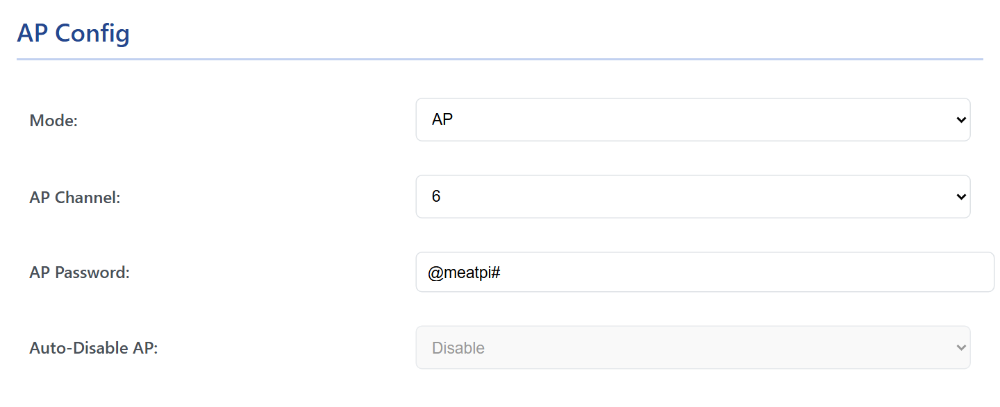
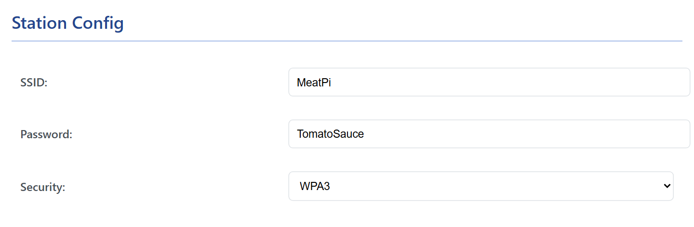
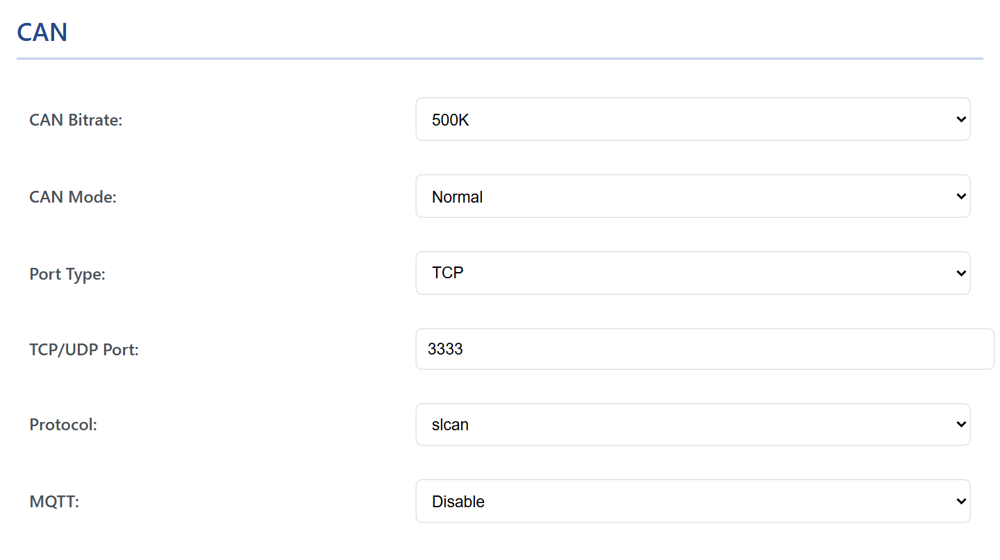
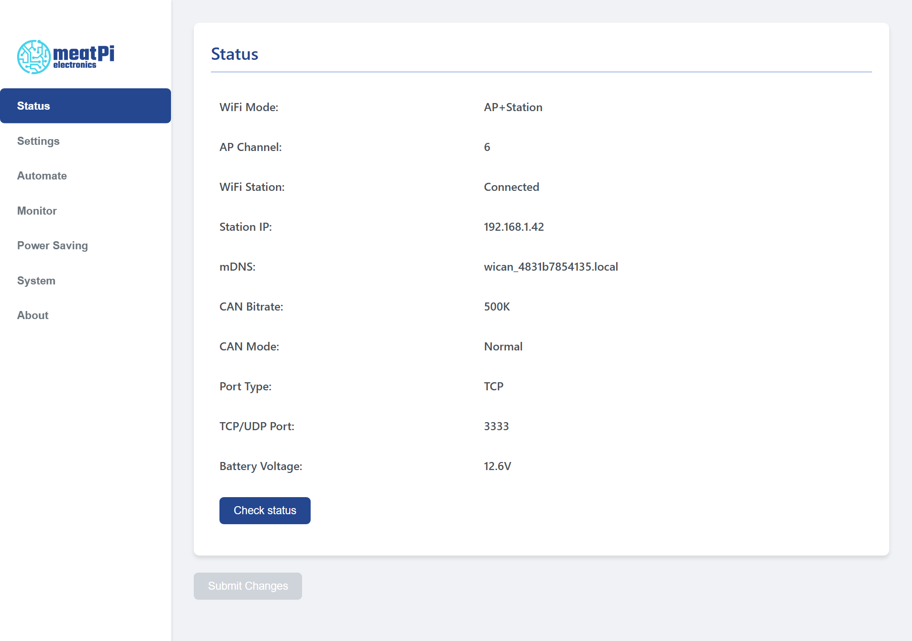

# First setup

Wire WiCAN USB to the bus, join its access point from your phone, give it a password of your own and put it on your WiFi. Everything happens in the browser; there is no app to install. If you only want a wired USB adapter, the first step and the [USB serial](../connectivity/usb-serial.md) chapter are all you need.

<dl class="facts" markdown>
<dt>You need</dt><dd>A phone or laptop with WiFi, a bus to connect to (or just a USB cable for now), and the name and password of your WiFi</dd>
<dt>Access point</dt><dd>`WiCAN_` followed by twelve letters and digits, factory password `@meatpi#`</dd>
<dt>Setup address</dt><dd>`http://192.168.80.1`</dd>
<dt>Saves</dt><dd>Nothing until you press ==Submit Changes==; WiCAN then restarts with the new settings</dd>
</dl>

1.  **Wire WiCAN USB**

    The screw terminal takes, in the order printed on the case: ==VIN== (7.5 V to 36 V), ==GND==, ==CANL== and ==CANH==. Connect CANH and CANL to the bus and GND to the bus ground. Power comes either from VIN or from the USB cable; for a first setup on the desk, the USB cable alone is enough. A bus end needs a 120 Ω termination, see [Hardware](hardware.md).

    The power LED lights as soon as WiCAN has power.

2.  **Join the WiCAN access point**

    On your phone, open the WiFi settings and pick the network whose name starts with `WiCAN_`. The factory password is `@meatpi#`.

    !!! tip
        Your phone may warn that this network has no internet. Stay connected anyway. If the phone keeps switching back to mobile data, turn mobile data off for a few minutes.

3.  **Open the web interface**

    In a browser, go to `http://192.168.80.1`. The ==Status== tab opens: WiFi mode `AP`, the mDNS name of your device, the CAN settings and the voltage on Vin (near zero when only the USB cable powers WiCAN).

    <figure class="shot" markdown>
    { width="760" }
    <figcaption>The Status tab on a new device. The seven tabs are on the left; Submit Changes stays grey until something is changed.</figcaption>
    </figure>

4.  **Set a new access point password**

    Open ==Settings==. Under ==AP Config==, replace `@meatpi#` in ==AP Password== with a password of your own, 8 to 63 characters. The factory password is the same on every WiCAN, so anyone in range could join until you change it.

    <figure class="shot" markdown>
    { width="640" }
    <figcaption>AP Config on a new device: access point only, channel 6, the factory password.</figcaption>
    </figure>

5.  **Join your WiFi**

    Set ==Mode== to ==AP+Station==. The ==Station Config== fields wake up: type the ==SSID== (the name of your network) and its ==Password==, and pick the ==Security== your router uses: ==WPA2== for most routers, ==WPA3== only if yours is set to WPA3. WiCAN joins 2.4 GHz networks only.

    <figure class="shot" markdown>
    { width="640" }
    <figcaption>Station Config. The fields are greyed out until Mode is AP+Station.</figcaption>
    </figure>

    ==Auto-Disable AP== decides what happens to the WiCAN access point once your network works: ==Disable== keeps it on (the factory setting), ==Enable== switches it off as long as WiCAN is connected to your network. Keep it on for now; you can turn it off once everything works, see [WiFi](../connectivity/wifi.md).

6.  **Choose how the bus is read**

    Under ==CAN==, set ==CAN Bitrate== to the speed of your bus (500K for a car's OBD port, 250K for most trucks and J1939 networks) and pick the ==Protocol==. Leave `slcan` if you are not sure; every use has its own chapter and the protocol can be changed any time.

    | Protocol | For |
    | --- | --- |
    | ==slcan== | SocketCAN, BUSMASTER and other CAN tools, over WiFi or the USB cable. The factory setting. |
    | ==elm327== | OBD apps such as Car Scanner, and RealDash's OBD2 mode. |
    | ==realdash66== | RealDash as a CAN device, over WiFi or the USB cable. |
    | ==savvyCAN== | SavvyCAN. |
    | ==AutoPID== | Home Assistant and MQTT: WiCAN reads the vehicle by itself. |

    <figure class="shot" markdown>
    { width="640" }
    <figcaption>The CAN card with the factory settings. Silent mode listens without ever transmitting, for a bus you must not disturb.</figcaption>
    </figure>

7.  **Submit**

    Press ==Submit Changes== at the bottom of the page. WiCAN answers `Configuration saved! Rebooting...` and restarts; the page goes quiet for about 20 seconds. If the button stays grey, a field is out of range and a red message at the top of the page says which one.

8.  **Find WiCAN on your network**

    Put your phone back on your WiFi and open WiCAN's new address. Your router's device list shows it as `WiCAN_<device id>`, and on most networks `http://wican_<device id>.local` works too; the device id is the twelve characters from the access point name, in lower case. While the WiCAN access point is still on, you can also join it again and read ==Station IP== off the Status tab.

    <figure class="shot" markdown>
    { width="760" }
    <figcaption>The Status tab of a WiCAN on a network: WiFi Station Connected, with the address the router gave it.</figcaption>
    </figure>

## What next

- **A wired CAN adapter**: [USB serial](../connectivity/usb-serial.md) for SocketCAN and RealDash over the cable.
- **Home Assistant or MQTT**: switch the protocol to ==AutoPID== and set up what to read, see [AutoPID](../vehicle-data/autopid.md), then [Home Assistant](../send-data/home-assistant.md) or [MQTT](../send-data/mqtt.md).
- **SavvyCAN, SocketCAN, BUSMASTER, RealDash, Car Scanner**: see [Apps over WiFi, BLE and USB](../send-data/apps.md).
- **A vehicle that sits for days**: with Vin on a 12 V battery, WiCAN draws power while the engine is off. Turn on sleep mode under ==Power Saving==, see [Sleep and battery alert](../power/sleep-and-wake.md).
- **The whole interface**: [The web interface](web-interface.md) is a tour of the seven tabs.

??? info "The page does not open at 192.168.80.1?"
    Make sure the phone is on the `WiCAN_` network and not on mobile data, and type the address with `http://`, not `https://`. A WiCAN that has been set up before may have the access point switched off while it is on a network (Auto-Disable AP); reach it through that network instead. [Common problems](../troubleshooting/common-problems.md) has the rest.
