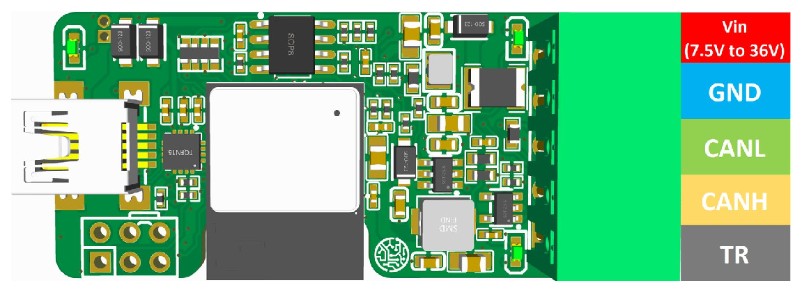

# Pinout

The screw terminal of WiCAN USB, position by position, and the termination resistor behind the TR position of the earlier boards.

<figure class="shot" markdown>
{ width="720" }
<figcaption>The board, as drawn in the firmware's README, with the five-position terminal of the earlier boards. Current boards have four positions, without TR.</figcaption>
</figure>

| Position | Connect to |
| --- | --- |
| ==VIN== | The supply, 7.5 V to 36 V: a 12 V car battery, a 24 V truck, a bench supply. Leave it open when the USB cable powers WiCAN. |
| ==GND== | The ground of the bus and of the supply. |
| ==CANL== | The CAN low wire of the bus. |
| ==CANH== | The CAN high wire of the bus. |
| ==TR== (earlier boards) | Nothing, or CANH to switch in the 120 Ω termination resistor: its other end is wired to CANL inside. |

Boards with four positions have no termination inside: put a 120 Ω resistor across CANH and CANL when WiCAN sits at the end of a bus you build yourself. [Hardware](../getting-started/hardware.md) explains when a bus needs it, and covers power, the USB port and the LEDs.

!!! tip "Tapping a car's OBD port"
    Pin 6 is CAN high, pin 14 CAN low, pins 4 and 5 ground and pin 16 the battery, which can feed VIN. The [WiCAN OBD pinout](../../wican-obd/hardware/pinout.md) shows them.
